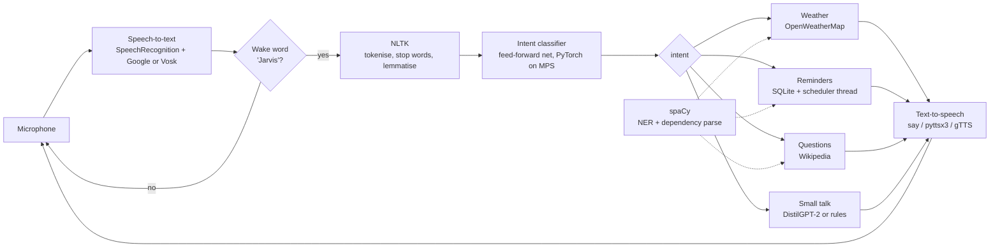

# J.A.R.V.I.S. — My Personal AI Assistant

Hey there, thanks for stopping by! 👋

I'm **Neeraj Yadav**, a master's student in Computer Science at the **University of Kansas**. Most of my time goes into deep reinforcement learning and applied machine learning, and I like turning what I learn into things I can actually use every day.

This project is one of those things. I wanted my own voice assistant, one I understood all the way from the microphone to the speaker, so I built **J.A.R.V.I.S.** in Python. You say **"Jarvis"**, and it can answer a question, set a reminder or tell you the weather. Let me walk you through it.

## Let me show you

Here's what talking to it looks like:

```
You:    Jarvis, remind me to submit the lab report tomorrow at 9 am
JARVIS: Okay, I'll remind you to submit the lab report tomorrow at 9 AM.
You:    What's the weather in Lawrence, Kansas?
JARVIS: Right now in Lawrence it's 72 degrees with clear sky. It feels like 70, humidity is 40 percent ...
You:    Who was Alan Turing?
JARVIS: Alan Mathison Turing was an English mathematician, computer scientist, logician ...
You:    Set a reminder
JARVIS: Sure. What should I remind you about?
You:    Call mom
JARVIS: When should I remind you to call mom?
You:    In 20 minutes
JARVIS: Okay, I'll remind you to call mom in 20 minutes.
```

Look at the last part: when I didn't give it enough to go on, it asked me follow-up questions instead of giving up. Getting that right was one of the things I cared about most.

## What you can ask it

| Ask | Examples |
|---|---|
| **Weather** (OpenWeatherMap) | "what's the weather", "how hot is it in Chicago", "will it rain tomorrow in Seattle" |
| **Reminders** (saved in SQLite, so they survive restarts) | "remind me to call mom at 5 pm", "remind me in 20 minutes to check the oven", "set a reminder for my dentist appointment on Friday", "what are my reminders", "delete all my reminders" |
| **Questions** (Wikipedia) | "who is Ada Lovelace", "what is machine learning", "tell me about black holes", "who invented the telephone" |
| **Time & date** | "what time is it", "what's today's date" |
| **Small talk** | jokes, "how are you", "I'm bored", plus generative chat once you fine-tune the chat model |

It also holds short conversations. It asks follow-up questions when it needs to ("Which city?", "When should I remind you?", "That will delete 3 reminders. Should I go ahead?"), and after each answer it keeps listening for a few seconds, so you don't have to say "Jarvis" again.

## How I built it

Jarvis listens with **SpeechRecognition**, understands you with **NLTK + spaCy** and an intent classifier I trained in **PyTorch** (with a **TensorFlow/Keras** twin), can chat using a **DistilGPT-2** model I fine-tuned, and talks back. Here's how one command flows through it:



I built it in seven steps, and each step lives in its own part of the code:

| Step | Where it lives | What it does |
|---|---|---|
| 1. Environment & hardware acceleration | `requirements*.txt`, `jarvis/device.py` | Picks PyTorch's `mps` device on Apple Silicon (CUDA/CPU elsewhere); TensorFlow uses the GPU through `tensorflow-metal` |
| 2. Speech-to-text listener | `jarvis/speech/listener.py` | Calibrates for background noise, spots the wake word even when it's misheard ("jervis"), uses Google Web Speech or offline Vosk |
| 3. NLP layer | `jarvis/nlp/` | NLTK: tokenising, stop-word removal, POS-aware lemmatising (or stemming). spaCy: city names (NER), the task inside "remind me to…" (dependency parse), question topics. Plus a parser for spoken times |
| 4. Conversational engine | `jarvis/brain/` | Bag-of-words feed-forward intent classifier in PyTorch *and* Keras; DistilGPT-2 fine-tuned on the Cornell Movie-Dialogs Corpus for small talk |
| 5. Action modules | `jarvis/skills/` | Weather (current + tomorrow), reminders (SQLite + background thread), Wikipedia answers, clock, jokes |
| 6. Text-to-speech | `jarvis/speech/speaker.py` | One speech thread; the microphone is closed while Jarvis talks, so it never hears itself |
| 7. Main event loop | `jarvis/app.py`, `main.py` | wake word → listen → classify → act → speak → short follow-up window → sleep; reminders are announced between listens |

## Try it yourself (Apple Silicon Mac)

I built this on an Apple Silicon Mac, so these steps are for that. You'll need [Homebrew](https://brew.sh). Run the blocks below in Terminal **one at a time**, in order. I kept them to commands only on purpose: zsh, the macOS shell, doesn't treat `#` as a comment when you paste, so a command with a note on the same line would break.

**1. System libraries.** PortAudio lets Python use the microphone. You also need flac, because the flac encoder bundled with SpeechRecognition is Intel-only and fails on Apple Silicon.

```bash
brew install python@3.12 portaudio flac
```

**2. A virtual environment.** I use Python 3.12 because it supports everything, including TensorFlow on Metal.

```bash
cd ~/Developer/"JARVIS AI"
python3.12 -m venv .venv
source .venv/bin/activate
python -m pip install --upgrade pip
```

**3. Dependencies, NLP data and the intent model.** This takes a few minutes.

```bash
pip install -r requirements.txt -r requirements-dev.txt
python scripts/setup_nlp.py
python -m jarvis.brain.train
```

**4. Settings.** Copy the template, then paste your free OpenWeatherMap key after `OPENWEATHER_API_KEY=` and save.

```bash
cp .env.example .env
open -e .env
```

**5. Check everything, then try it.** I'd start with text mode:

```bash
python main.py --doctor
python main.py --text
```

Once that works, start voice mode and say "Jarvis":

```bash
python main.py
```

Every new Terminal window needs the virtual environment activated before you run Jarvis:

```bash
cd ~/Developer/"JARVIS AI"
source .venv/bin/activate
```

> **Microphone permission:** the first time you run voice mode, macOS asks whether your terminal app may use the microphone. If you missed it, go to **System Settings → Privacy & Security → Microphone** and enable Terminal (or iTerm, VS Code, PyCharm, whichever you run it from).

> **Weather key:** sign up at [openweathermap.org](https://home.openweathermap.org/api_keys) (free tier). New keys can take up to a couple of hours to start working.

## Using it

* **Voice mode** (`python main.py`): wait for "Jarvis is online", then say *"Jarvis"* and your request, either in one breath ("Jarvis, what time is it?") or by waking it first ("Jarvis." → "Yes, sir?" → "What time is it?"). Say *"that's all"* to send it back to sleep, *"shut down"* to exit, or press Ctrl+C.
* **Text mode** (`python main.py --text`): the same brain, with a keyboard. Add `--speak` to hear the replies.
* **`--debug`** shows the detected intent and confidence for every command.
* **`--list-mics`** lists input devices if you want to pick a specific microphone (`MIC_DEVICE_INDEX` in `.env`).

## Settings

Everything lives in `.env`, and `.env.example` explains each setting. These are the ones you're most likely to change:

| Setting | Default | Meaning |
|---|---|---|
| `OPENWEATHER_API_KEY` | – | needed for weather |
| `DEFAULT_CITY` | `Lawrence,KS,US` | used when you don't name a city (Lawrence, home of KU) |
| `UNITS` | `imperial` | or `metric` |
| `STT_ENGINE` / `WAKE_ENGINE` | `google` | `vosk` for offline recognition |
| `TTS_ENGINE` / `TTS_VOICE` | `auto` / `Daniel` | `say`, `pyttsx3`, `gtts` or `print`; Daniel is the British macOS voice |
| `HONORIFIC` | `sir` | leave it empty if you'd rather not be called sir |
| `INTENT_BACKEND` | `torch` | `tf` for the Keras model |
| `FOLLOW_UP_SECONDS` | `6` | how long Jarvis keeps listening after answering |

## Extras I added

### TensorFlow / Keras backend on Metal
I built the intent classifier in Keras too, layer for layer the same as the PyTorch one, so I could compare the two frameworks directly. In my testing they scored the same. This installs TensorFlow 2.18.1 with tensorflow-metal, which needs Python 3.12 or older:

```bash
pip install -r requirements-tf.txt
python -m jarvis.brain.train --backend tf
```

Then set `INTENT_BACKEND=tf` in `.env`. `python main.py --doctor` tells you whether TensorFlow can see the Apple GPU. (I pinned the versions because tensorflow-metal hasn't kept up with newer TensorFlow releases.)

### Offline speech recognition (Vosk)
Download the small English model (about 40 MB):

```bash
python scripts/download_vosk.py
```

Then set `STT_ENGINE=vosk` to run fully offline, or just `WAKE_ENGINE=vosk`. With that setting the wake word is spotted locally and privately, and only the actual command goes to Google.

### Generative small talk: DistilGPT-2 on the Cornell Movie-Dialogs Corpus
I didn't want small talk to be only canned replies, so I fine-tuned DistilGPT-2 on movie dialogue. Start with a quick trial on 5,000 dialogue pairs:

```bash
python scripts/finetune_chat.py --max-pairs 5000
```

The full run uses 50,000 pairs for one epoch:

```bash
python scripts/finetune_chat.py
```

The script downloads the corpus (ConvoKit's `movie-corpus`, or you can unzip the original release into `data/cornell/`) and fine-tunes `distilgpt2` on the Apple GPU. It saves the result to `models/chat/`, and Jarvis uses it for small talk from the next start.

A few choices I made here:
* I compute the loss only on the reply tokens, so the model learns to answer rather than to imitate the user.
* Movie scripts can get colourful, so I filter the generated replies. If a reply comes out empty or inappropriate, Jarvis falls back to a rule-based one.
* If you want more coherent chat, try `--base-model microsoft/DialoGPT-small`, a GPT-2 that's already trained on conversations.

## How I tested it

The suite has 206 tests. It takes about a minute and needs no microphone or internet:

```bash
python -m pytest
```

It covers:
* NLTK normalisation, the time parser (50+ phrasings) and spaCy extraction.
* Classifier accuracy, on both backends.
* Reminders, including the scheduler thread.
* Weather and Wikipedia, against mocked HTTP.
* Complete multi-turn conversations.
* The voice loop, driven by a scripted fake microphone.
* DistilGPT-2 fine-tuning on a tiny model.

For the intent classifier (16 intents, 581 training patterns, trains in well under a minute), I measured accuracy three ways, and I want to be upfront about what each number means:

| Evaluation | Accuracy |
|---|---|
| 20% of the patterns held out | 78%. This is pessimistic: many patterns contain words that appear nowhere else in the data |
| 115 realistic commands not in the training data (`tests/data/heldout_utterances.json`) | 100%. But I used this set while designing the training data, so it isn't a blind test |
| 61 commands I wrote afterwards and never tuned on (`tests/data/blind_utterances.json`) | **93%**. This is the honest estimate |

Two tricks helped the small model generalise:
* Placeholder slots in `intents.json` (`who is {x}`), plus extra copies of every pattern with an unknown word added. That way, names it has never seen don't drag predictions toward one intent.
* Label smoothing keeps the confidence scores meaningful, so commands below `CONFIDENCE_THRESHOLD` go to small talk instead of triggering the wrong action.

## Project layout

```
JARVIS AI/
├── main.py                    # entry point: voice / --text / --doctor / --list-mics
├── jarvis/
│   ├── config.py              # settings from .env
│   ├── device.py              # MPS / CUDA / Metal detection
│   ├── assistant.py           # text in -> reply out: intent routing + follow-up questions
│   ├── app.py                 # main event loops (voice and text)
│   ├── doctor.py              # set-up checker
│   ├── nlp/
│   │   ├── preprocess.py      # NLTK pipeline
│   │   ├── entities.py        # spaCy: cities, reminder tasks, question topics
│   │   └── timeparse.py       # "tomorrow at 9", "in half an hour", "quarter past 5" ...
│   ├── brain/
│   │   ├── intents.json       # training data + canned responses
│   │   ├── dataset.py         # bag-of-words features
│   │   ├── model_torch.py     # PyTorch network
│   │   ├── model_tf.py        # Keras network
│   │   ├── train.py           # training + evaluation  (python -m jarvis.brain.train)
│   │   ├── classifier.py      # inference
│   │   ├── chat.py            # small-talk engine
│   │   ├── chat_training.py   # DistilGPT-2 fine-tuning loop
│   │   └── cornell.py         # Cornell Movie-Dialogs loader
│   ├── skills/                # weather, reminders, knowledge (Wikipedia), clock, jokes
│   └── speech/                # listener (STT + wake word) and speaker (TTS)
├── scripts/                   # setup_nlp.py, finetune_chat.py, download_vosk.py
├── tests/                     # pytest suite + labelled evaluation sets
├── models/                    # trained models (generated, git-ignored)
└── data/                      # reminder database, corpus downloads (generated, git-ignored)
```

## Teaching Jarvis new commands

Jarvis doesn't learn while you talk to it. It learns from the example sentences in `jarvis/brain/intents.json` every time you retrain. There are three cases:

**1. A new way to say an existing command.** Say you want "is it a good day for a run" to mean weather. Add the sentence to that intent's `"patterns"` list and retrain.

**2. A new command that just answers.** A coin flip, for example. Add a new intent with `"patterns"` and `"responses"`, and retrain. Jarvis replies with one of the responses, picked at random, and you don't need to write any Python:

```json
{
  "tag": "coin_flip",
  "patterns": ["flip a coin", "toss a coin", "heads or tails", "coin toss", "can you flip a coin"],
  "responses": ["It's heads.", "It's tails."]
}
```

**3. A new command that does something** (open a website, play music...). Do case 2, then write a handler method in `jarvis/assistant.py` and register it in `self._handlers`. A handler receives the command text and returns a `Reply`.

After any change, retrain, then try it with `--debug` to see which intent it picks and how confident it is:

```bash
python -m jarvis.brain.train
python main.py --text --debug
```

A few tips:
* Give a new intent 15–20 or more varied examples. The more different they are, the better it generalises.
* Use `{x}` for the parts that change, such as names, places or tasks.
* Watch the two accuracy lines the trainer prints. A big drop means a new example overlaps with another command.
* Add a test in `tests/test_assistant.py`.

## Why I built it this way

* **Bag-of-words + a small feed-forward network instead of a transformer for intents.** With about 600 examples it trains in seconds and runs in under a millisecond. It's also easy to inspect: `--debug` shows the exact tokens it saw.
* **My own stop-word list.** NLTK's default list removes "who", "how", "you" and "can". But those words are exactly what separates "who are you" from "how are you", and "what can you do" from "what are you", so I kept them.
* **Dependency parsing for reminder tasks.** The task is the clause attached to "remind" or "reminder", so "set a reminder to submit the assignment tomorrow at 9" gives *submit the assignment*. Regex fallbacks cover lower-case speech transcripts, where spaCy's NER is weaker.
* **Reminders in SQLite, checked by a background thread.** The roadmap I started from suggested the `schedule` library, but it's built for *recurring* jobs and keeps them in memory, so one-off reminders would vanish on restart. With SQLite, anything that came due while Jarvis was off gets announced the next time it starts.
* **One thread owns the microphone and the speaker.** Reminders fire on the scheduler thread, but they're queued and spoken between listens. The microphone is only open while Jarvis is listening, so it can't transcribe its own voice.
* **macOS `say` by default.** It uses the same voices as pyttsx3's macOS driver but runs in a separate process, so speech can never freeze the assistant. `TTS_ENGINE=pyttsx3` switches to pyttsx3, and every speech engine runs on a single worker thread with a watchdog.

## Troubleshooting

If something goes wrong, check here first:

| Symptom | Fix |
|---|---|
| `Could not find PyAudio` / `portaudio.h not found` | `brew install portaudio`, then `pip install --force-reinstall pyaudio` |
| Jarvis never hears you | Allow microphone access for your terminal app (System Settings → Privacy & Security → Microphone); run `python main.py --list-mics` and set `MIC_DEVICE_INDEX` |
| `Bad CPU type in executable` or a FLAC error | `brew install flac` |
| Weather says the key was rejected | New OpenWeatherMap keys take up to ~2 hours to activate |
| NLTK download refused ("proxied fetch") | NLTK 3.10+ refuses downloads through a proxy unless you set `NLTK_ALLOW_PROXIED_URLOPEN=1` |
| TensorFlow fails to load `libmetal_plugin.dylib` | Use Python 3.12 with the versions pinned in `requirements-tf.txt`, or stay on the PyTorch backend |
| Wake word sometimes missed | Pause briefly after "Jarvis". With Google, each phrase is transcribed before the next listen starts; `WAKE_ENGINE=vosk` spots the wake word locally and much faster |

## What it can't do (yet)

I'd rather be honest about the limits:

* The wake word is spotted by transcribing short phrases, not by a dedicated hot-word model, so there's a short deaf moment while each phrase is processed.
* Bag-of-words ignores word order, so unusual phrasings can still be misclassified. About 7% of my blind test commands were.
* Weather covers current conditions and tomorrow's forecast only.
* Generative chat is limited by DistilGPT-2 and movie dialogue: entertaining rather than wise.

## Thanks for reading!

That's Jarvis! If you try it out, I'd love to hear how it goes, and if you have ideas for new commands, I'm all ears.

— Neeraj
